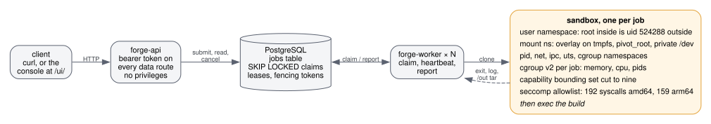
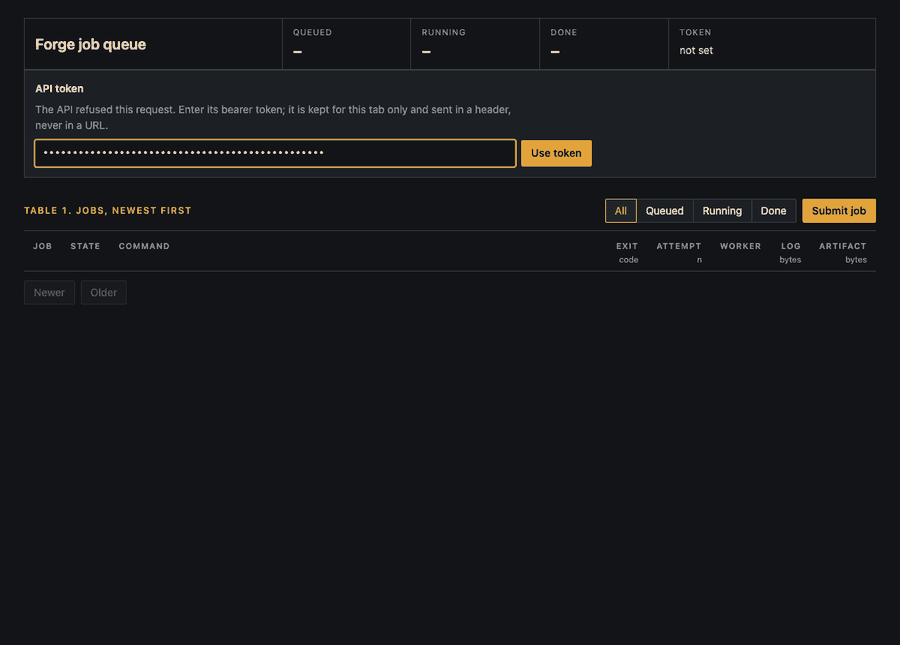

# Forge

Forge runs untrusted build commands for you. You submit a job over an HTTP API or
the built-in web console, a worker claims it from a PostgreSQL queue, and the
command runs in a Linux sandbox that Forge builds itself from namespaces,
cgroups v2, `pivot_root`, a capability bounding set and a seccomp allowlist. It
does not use Docker, runc or a container library.



It is written in Go, with two direct dependencies (`pgx/v5` and `cilium/ebpf`).
It is a learning project taken to a finished state, not a production service.
Every claim below links to the test that proves it, and
[Limitations](#limitations) says what Forge does not defend against.

## Demo



A real run on the development VM. A job tries twelve ways out of the sandbox:
reading the host through PID 1, mounting the disk, creating a namespace,
loading a kernel module, reaching the network, a fork bomb and a memory hog.
Each is refused by the control named in its label, and then a normal build
downloads its artifact. [docs/demo.md](docs/demo.md) has the full log and says
why each attempt fails.

## What it does

- **Sandbox** (`internal/sandbox`). Every job gets seven fresh namespaces:
  - **user**: root inside is an unprivileged uid on the host;
  - **mount**: a per-job overlay root, a private `/dev`;
  - **pid**, **net** (loopback only), **ipc** and **uts**;
  - **cgroup**.

  Each job also gets its own cgroup with memory, CPU and pid limits, entered at
  clone time. The capability bounding set is cut to nine. A deny-by-default
  seccomp filter (192 syscalls allowed on amd64, 159 on arm64) also refuses
  `clone` with namespace flags.
- **Queue** (`internal/queue`). A job is a row in PostgreSQL. Workers claim
  with `FOR UPDATE SKIP LOCKED` and hold a lease by heartbeating. Every claim
  carries a fencing token, so a worker that lost its lease cannot report a
  result. Delivery is at-least-once, and a job that keeps killing workers is
  given up after `-max-attempts`.
- **Worker** (`cmd/forge-worker`). It runs N claim loops, streams each job's
  output into its row while it runs, collects the files a build leaves in
  `/out` as a capped tar, and handles cancel, timeout and drain on `Ctrl-C`.
- **API** (`cmd/forge-api`). It submits, lists, follows logs, cancels and
  downloads artifacts. Every data route needs a bearer token, compared in
  constant time.
- **Console** (`/ui/`). Three static files are embedded in `forge-api`. They
  are the only thing served without the token, and they hold no job data. The
  console renders everything as text, is served with a strict CSP, and keeps
  the token in `sessionStorage`, never in a cookie or URL.
- **Operations.** Prometheus metrics come from both binaries, and optional
  per-job syscall counts come from eBPF. The repo also ships systemd units
  (verified in CI) and a benchmark harness.

## Quickstart

You need Linux 5.7+ with cgroups v2, root (for the worker), Go 1.27+, and a
PostgreSQL reachable as `$DSN`. On macOS, run it inside a VM (see
[Testing](#testing)).

```sh
make rootfs                                       # Alpine image, pinned by SHA-256
go build -o . ./cmd/forge-api ./cmd/forge-worker
sudo install -m 0755 forge-api forge-worker /usr/local/bin/
export FORGE_API_TOKEN=$(openssl rand -hex 32)
forge-api -dsn "$DSN" -listen 127.0.0.1:8080 &
sudo forge-worker -dsn "$DSN" -rootfs /var/tmp/forge-rootfs -workers 2 -memory-mb 256 -pids 64 &
curl -s -H "Authorization: Bearer $FORGE_API_TOKEN" 127.0.0.1:8080/jobs -d '{"args": ["/bin/sh", "-c", "echo hello from $(hostname)"]}'
```

Open `http://127.0.0.1:8080/` and paste the token to use the console, or follow
the job with `curl -sN -H "Authorization: Bearer $FORGE_API_TOKEN"
127.0.0.1:8080/jobs/1/logs`. The worker must be installed somewhere the
sandbox's mapped uid can execute it (see [Requirements](#requirements)), which
is why it goes to `/usr/local/bin`.

To run it as a service, see [docs/deployment.md](docs/deployment.md) for the
systemd units, cgroup delegation and database setup.
[docs/walkthrough.md](docs/walkthrough.md) shows each layer on its own with real
output: the sandbox through `forged`, limits, `/dev`, the uid map, the overlay,
the API and metrics.

## Testing

```sh
make test          # gofmt check, go vet, go test -race (any OS; queue tests need FORGE_TEST_DSN)
make test-sandbox  # the isolation tests: Linux, root, unpacks a rootfs
make vm-test       # the same, from a macOS host, inside a colima VM (VM='colima -p <profile>')
make mutate        # break the sandbox 27 ways and check a test notices each
make mutate-queue  # break the queue 8 ways, against FORGE_TEST_DSN
make fuzz          # fuzz the seccomp filter against its policy (Linux, no root)
make bench         # sandbox setup latency and jobs per second (Linux, root)
```

The queue's tests run against a real PostgreSQL named by `FORGE_TEST_DSN`. They
skip without one on a developer's machine and fail without one in CI. CI runs
on `ubuntu-latest` with PostgreSQL 17. It runs `make test`, the sandbox tests
as root, the fuzzer for 30 seconds, the eBPF tests, the benchmarks, and
`systemd-analyze verify` on the units.

The repo has 161 test functions, one fuzz target and four benchmarks. The
sandbox, cgroup and worker suites report 297 passing tests and subtests on the
development VM.

## Numbers

These come from `make bench` in CI on GitHub-hosted `ubuntu-latest` runners
(x86_64, `GOMAXPROCS` 2 as Go saw it, PostgreSQL 17 in a service container, the
Alpine image). Each run is twenty iterations. The range covers the three runs
on `main` on 2026-11-08, at commits 1bc2473, 3bd0dda and 9d36880 (Actions runs
42458221829, 42458249205 and 42458768563, `bench` step).

| Benchmark | What it measures | Result (3 runs) |
|---|---|---|
| `BenchmarkRun` | one sandbox: namespaces, overlay, `/proc`, `/dev`, `pivot_root`, bounding set, seccomp, `exec /bin/true`, teardown | 4.2–6.2 ms |
| `BenchmarkRunWithLimits` | the same with a cgroup per job | 4.3–6.5 ms |
| `BenchmarkThroughput` | jobs through the queue and the sandbox, four loops, `/bin/true` | 5.3–7.1 ms per job, about 140–190 jobs/s |

Shared runners are noisy. Across those three runs and the three on
[PR #15](https://github.com/parth-sharma-10/forge/pull/15), one sandbox took
3.7–6.2 ms and one job took 5.3–33.4 ms. Treat these figures as what the
harness measured on those runs, not as a guarantee. None are quoted from the
development VM, whose numbers swung threefold between runs because it was also
hosting another project's Kubernetes cluster.
[docs/failures.md](docs/failures.md) has that story.

## Security claims

| A build cannot | Held by | Proven by |
|---|---|---|
| become a privileged host user | user namespace: uid 0 inside is 524288 outside | `TestSandboxRootIsAnUnprivilegedHostUid` |
| reach the host filesystem | mount namespace, bind + `pivot_root` + detach | `TestHostFilesystemIsUnreachable` |
| change the shared image | per-job overlay on a tmpfs | `TestTheImageIsNeverWritten` |
| reach the network | network namespace with no interfaces but loopback | `TestNetworkNamespaceHasNoHostInterfaces` |
| call `mount`, `ptrace`, `bpf`, `init_module`, `unshare`… | seccomp allowlist | `TestFilterDeniesTheKernelFacingSurface`, `FuzzFilterMatchesPolicy` |
| create namespaces of its own | `clone` filtered on `CLONE_NEW*`; `clone3` denied | `TestABuildCannotCreateANamespace` |
| keep `CAP_SYS_ADMIN` | bounding set cut to nine | `TestTheBoundingSetIsTheKeepList` |
| open a host disk or `/dev/mem` | private `/dev`: six nodes, checked by major:minor | `TestDevIsOnlyTheMinimalSet` |
| escape its memory limit unreported | cgroup v2 entered at clone time; `memory.events` | `TestMemoryLimitIsReportedAsAnOOMKill` |
| inherit a host file descriptor (the CVE-2024-21626 class) | `O_CLOEXEC` everywhere, raw `execve` | `TestNoHostDescriptorLeaksIntoTheBuild` |
| get a stale result accepted | fencing token per claim | `TestAStaleFenceCannotReportOrHeartbeat`, `make mutate-queue` |
| reach job data through the console without the token | only three static files are outside the token check | `TestDataRoutesStillNeedToken`, `TestPathTricksDoNotBypassAuth` |
| run script in the operator's browser through its output | text-only rendering, strict CSP, header-only token | `TestConsoleScriptHasNoHTMLSinks`, browser check in [#39](https://github.com/parth-sharma-10/forge/pull/39) |

[docs/threat-model.md](docs/threat-model.md) has the full table (20 boundaries)
with the code for each. It also states what is *not* defended, the largest gap
being a kernel exploit through an allowed syscall. `make mutate` removes each
property in turn and checks that a test fails.

## Limitations

Every job on a worker is mapped to the same host uid range. Since the overlay,
no two jobs share a writable filesystem, so what remains of that is on the
host's side: everything any job creates outside its layer — nothing, today —
would belong to the same ids.

The overlay's upper layer is a tmpfs. `-disk-mb` caps it, bytes and inodes
both, so a build that fills it gets `ENOSPC` rather than an OOM kill; without
the flag it has the kernel's default cap, half of RAM, and a job's memory limit
is what stops it first. `-timeout` (an hour by default) kills a build that runs
past it and reports it as `timeout`.

A build hands files back by leaving them in `/out`. The worker collects them
as a tar of up to `-artifact-mb` (16 MiB by default; 0 turns collection off)
and keeps the tar only for a build that exited, not for one that was killed.
It is collected inside the sandbox after everything the build started has been
killed: symlinks are recorded, never followed, and anything past the cap is
left out and reported in the log ([docs/artifacts.md](docs/artifacts.md)).
The tar is the build's output and should be extracted as untrusted input.

The seccomp filter is an allowlist of syscall *numbers*, with one exception:
`clone` is also checked for `CLONE_NEW*` flags, and refused with `EPERM` when
it carries any, so a build can fork and thread but not create namespaces of
its own. `clone3` is denied by number, since its flags are in a struct the
filter cannot read; glibc falls back to `clone`. An unlisted syscall returns
`ENOSYS`, which is what lets a C library fall back to an older call rather
than fail outright — and which makes a denial read like an old kernel in a
build log rather than like a denial.

The `/dev` the sandbox provides is six nodes and four symlinks, and nothing
else. A build that wants a pty or POSIX shared memory (`/dev/ptmx`,
`/dev/shm`) does not get one yet. Making new device nodes is denied twice over:
the filter answers `mknod` with `ENOSYS`, and the user namespace would refuse
it anyway.

A build holds nine capabilities after `execve` — chown, dac_override, fowner,
fsetid, kill, setgid, setuid, net_bind_service, setfcap — and no others, in
any set. `CAP_SYS_ADMIN` is gone before the build starts. The bounding set is
what enforces it, and the set only shrinks; `CAP_SETPCAP`, which shrinks it,
is not among the nine. The kept list is decided by what the tests show a
package manager doing, not by what a build might someday want.

Delivery is at-least-once. A worker that dies after the build and before
the report leaves a job whose lease expires and is run again; the row's
attempt count says it happened, and nothing makes the second run unnecessary
— idempotent jobs are the caller's business.

The API's authentication is one shared bearer token, not users or roles. It
has no webhook — a webhook is a client of `POST /jobs` and can live anywhere.

[docs/threat-model.md](docs/threat-model.md) is the whole of this — what each
boundary is, the code and test that hold it, and what Forge does not defend
against at all, the largest being a kernel exploit through an allowed syscall.

## Requirements

Go 1.27+, PostgreSQL for the queue, and two direct third-party dependencies: `pgx/v5`,
its driver, and `cilium/ebpf`, for the optional syscall metrics.

The sandbox needs `CAP_SYS_ADMIN` and a Linux kernel with cgroups v2 and
`CLONE_INTO_CGROUP` — 5.7 or newer. It re-executes itself after dropping to the
mapped uid, so the Forge binary has to be readable and executable by that uid:
a worker installed mode `0700` starts nothing.

It also needs a fully visible `/proc` on the host, which is what a worker
running inside another container usually does not have — a masked `/proc`
leaves the sandbox unable to mount one of its own, and the kernel reports that
as `EPERM` rather than as what it is. Those packages are behind `//go:build
linux`; CI runs their tests on `ubuntu-latest`, and a macOS host runs them
through `make vm-test` against a colima VM.

## Layout

```
cmd/forge-api      HTTP API and the embedded console
cmd/forge-worker   job executor: claim, run, heartbeat, report
cmd/forged         the sandbox on its own, for one command
internal/api       routes, auth, log streaming, console (/ui/)
internal/queue     PostgreSQL queue, leases, fencing tokens
internal/worker    claim loops, cancel, timeout, artifacts
internal/sandbox   namespaces, pivot_root, /dev, uid map, capabilities, seccomp
internal/cgroup    cgroups v2 memory/cpu/pids
internal/syscalls  eBPF per-job syscall counts (opt-in)
internal/metrics   Prometheus text format
deploy/            systemd units
hack/              rootfs shift, mutation harness, escape demo
docs/              walkthrough, architecture, threat model, decisions, failures
```

## Documentation

- [docs/walkthrough.md](docs/walkthrough.md): each layer shown with commands and real output
- [docs/demo.md](docs/demo.md): the escape-attempt run, verbatim
- [docs/architecture.md](docs/architecture.md): what is implemented, and how
- [docs/threat-model.md](docs/threat-model.md): every boundary, its code and its test, and what is not defended
- [docs/deployment.md](docs/deployment.md): systemd units, cgroup delegation, database, metrics
- [docs/artifacts.md](docs/artifacts.md): how `/out` is collected safely
- [docs/decisions.md](docs/decisions.md) and [docs/failures.md](docs/failures.md): why it is built this way, and what went wrong on the way
- [docs/roadmap.md](docs/roadmap.md) and `docs/phase-0.md` to `docs/phase-5.md`: what "done" meant for each phase
