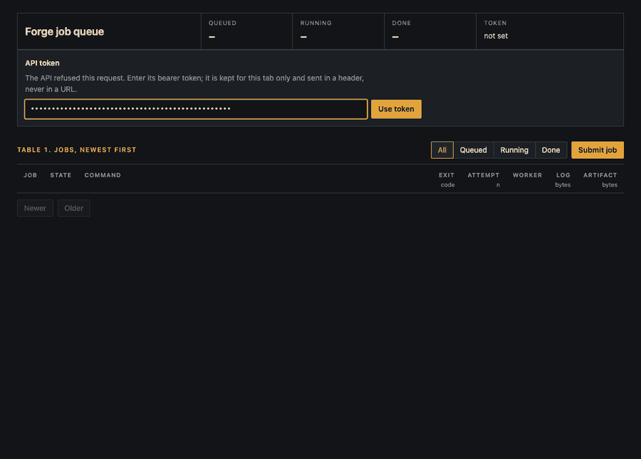

# Escape-attempt demo



The recording is a real run, not a mock-up. A job submitted through the console
at `/ui/` tries twelve ways out of the sandbox. Each attempt is refused, the job
still exits 0, and then a normal build runs and its artifact downloads as
`job-<id>.tar`. The script is [`hack/escape-demo.sh`](../hack/escape-demo.sh).
Each attempt is labelled with the control that stops it.

## Where it ran

- colima VM `forge-cve`: arm64, kernel 6.8.0-100, PostgreSQL 16, Alpine 3.21.3 rootfs.
- `forge-api` and `forge-worker` built from `main` at 9d36880, recorded 2026-11-08.
- Worker flags: `-workers 2 -memory-mb 256 -pids 64 -timeout 2m`.
- Frames were captured from a headless Chrome with a clean profile at 1200×860 and encoded as a GIF. Nothing in the recording was edited.

## The job's log, verbatim (job 102)

```text
== who am I [user namespace]
$ id -u; cat /proc/self/uid_map
0
         0     524288      65536
-> exit 0

== capabilities left [bounding set]
$ grep CapBnd /proc/self/status
CapBnd:	00000000800004fb
-> exit 0

== host root via PID 1 [pid ns, non-dumpable supervisor]
$ ls /proc/1/root
ls: /proc/1/root: Permission denied
-> exit 1

== climb out with .. [pivot_root]
$ cd /../../..; ls | tr "\n" " "
bin dev etc home lib media mnt opt proc root run sbin srv sys tmp usr var 
-> exit 0

== mount the host disk [seccomp]
$ mount /dev/vda1 /mnt
mount: mounting /dev/vda1 on /mnt failed: Function not implemented
-> exit 255

== new user namespace [seccomp]
$ unshare -U -r id
unshare: unshare(0x10000000): Function not implemented
-> exit 1

== load a kernel module [seccomp]
$ head -c 64 /dev/zero > /tmp/m.ko; insmod /tmp/m.ko
insmod: can't insert '/tmp/m.ko': kernel does not support requested operation
-> exit 38

== reboot the machine [seccomp]
$ reboot -f
reboot: : Function not implemented
-> exit 1

== raw disk [private /dev]
$ cat /dev/sda
cat: can't open '/dev/sda': No such file or directory
-> exit 1

== network [net namespace]
$ wget -q -T 3 -O- http://1.1.1.1
wget: can't connect to remote host (1.1.1.1): Network unreachable
-> exit 1

== fork bomb [pids cgroup]
$ i=0; while [ $i -lt 200 ]; do sleep 5 & i=$((i+1)); done
sh: can't fork: Resource temporarily unavailable
-> exit 2

== memory hog [memory cgroup]
$ x=aaaaaaaaaaaaaaaa; while :; do x=$x$x; done
Killed

-> exit 137

== every attempt refused; the job itself exits 0
```

```json
{"id":102,"state":"done","attempt":1,"worker":"vm-worker","exit_code":0,"oom_killed":false,"log_bytes":1545}
```

## Reading the results

- **User namespace.** Root inside the sandbox is uid 524288 on the host.
- **Bounding set.** `0x800004fb` is nine capabilities: chown, dac_override, fowner, fsetid, kill, setgid, setuid, net_bind_service and setfcap. `CAP_SYS_ADMIN`, `CAP_SYS_MODULE` and `CAP_SYS_BOOT` are not among them.
- **PID 1.** PID 1 in the sandbox is Forge's artifact supervisor, which makes itself non-dumpable, so its `/proc/1/root` and `/proc/1/ns/*` cannot be opened (`EACCES`). Even if they could, PID 1 is in the sandbox's own PID and mount namespaces, so the path would lead back to the sandbox root.
- **`..`.** After `pivot_root`, `/..` is `/`. The listing is the Alpine image, not the VM.
- **Seccomp.** `mount`, `unshare`, `init_module`/`finit_module` and `reboot` are not on the allowlist, so each returns `ENOSYS` ("Function not implemented"; `insmod`'s exit 38 is `ENOSYS`). The capability bounding set would refuse the first three as well.
- **`/dev`.** It holds six character devices and four symlinks. There is no `/dev/sda` or `/dev/vda` to open.
- **Network.** The network namespace has only a loopback interface, and it is down.
- **pids cgroup.** `-pids 64` makes `fork` fail with `EAGAIN` long before 200 processes.
- **memory cgroup.** `-memory-mb 256` lets the kernel OOM-kill the hog, which here is a child shell. The build itself keeps running and exits 0, which is why the job reports `oom_killed: false`: Forge checks the cgroup's `oom_kill` counter only when the build fails ([`sandbox_linux.go`](../internal/sandbox/sandbox_linux.go), after the wait). A build whose own process is OOM-killed is reported `oom_killed: true`, which `TestMemoryLimitIsReportedAsAnOOMKill` proves.

Each of these controls has its own test. The table in [threat-model.md](threat-model.md#boundaries-and-what-holds-them) maps every one to the code and the test that prove it. The demo shows those controls working together in a running system, through the same API a user would call.

## Reproducing it

With `forge-api` and `forge-worker` running as in the [quickstart](../README.md#quickstart), submit the script as a job:

```sh
python3 -c 'import json; print(json.dumps({"args": ["/bin/sh", "-c", open("hack/escape-demo.sh").read()]}))' |
  curl -s -H "Authorization: Bearer $FORGE_API_TOKEN" -d @- 127.0.0.1:8080/jobs
```

You can also paste the script into the console's *Submit job* form.
